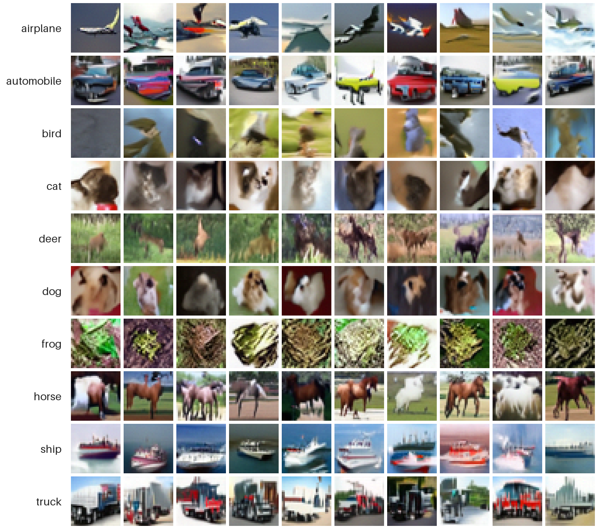

# Pixel-space DiT on CIFAR10

A class-conditional **Diffusion Transformer (DiT)** trained from scratch in pixel space, with
classifier-free guidance and several guidance variants for sampling. The training script also
accepts a local ImageNet folder, but only CIFAR10 has been evaluated.



*CIFAR10 samples, one class per row*

## Results

All results use a 32.6M-parameter DiT trained for 200 epochs.

CIFAR10, 10,000 samples per setting, 50 sampling steps. FID is computed from these 10k
samples against the 10k test images, so it is not comparable to the usual FID-50k. cFID
averages the ten per-class FIDs; class accuracy comes from a pretrained ResNet20.

| Guidance | Setting | FID ↓ | cFID ↓ | IS ↑ | Class acc. ↑ |
| --- | --- | ---: | ---: | ---: | ---: |
| Fixed CFG (DDIM) | w = 2.0 | **28.6** | **76.1** | 7.91 | 77.0% |
| Fixed CFG (DDIM) | w = 7.5 | 46.9 | 106.3 | 8.47 | 90.4% |
| CFG Rescale (DDIM) | w = 7.5, φ = 1.0 | 45.6 | 104.6 | 8.53 | **91.0%** |
| CFG++ | λ = 0.4 | 31.4 | 82.3 | 8.26 | 86.0% |
| Guidance interval (DDIM) | w = 7.5, σ ∈ [0.19, 1.61] | 30.1 | 80.8 | **8.70** | 87.6% |

Stronger fixed guidance raises class accuracy but hurts FID; the guidance interval and CFG++
keep most of the accuracy at near-best FID. Learned adaptive CFG has not been evaluated yet.

## Key design choices

- **Pixel-space**: the model patchifies raw RGB images directly — no VAE.
- **adaLN-Zero** conditioning: timestep + class embeddings drive per-block shift/scale/gate,
  initialized to zero so each block starts as identity.
- **Classifier-free guidance**: a fraction (`--class_dropout_prob`) of labels is dropped to a
  null token during training, so one network learns both conditional and unconditional
  predictions.
- **EMA** weights are used for all sampling.

## Setup

```bash
uv sync                                   # or: python -m pip install -r requirements.txt
```

Requires Python 3.10+. For a GPU, install the PyTorch build that matches your CUDA version.
Run all commands from the repository root.

## Train

```bash
uv run python train.py --dataset cifar10 --image_size 32 --patch_size 2 \
    --hidden_size 384 --depth 12 --num_heads 6 --batch_size 128 --epochs 100 \
    --output_dir runs
```

Each run writes preview grids and checkpoints to a timestamped folder under `--output_dir`
(`runs/YOUR_RUN/` below). Resume with `--resume runs/YOUR_RUN/dit_cifar10_epoch_50.pth`, and
enable Weights & Biases logging by passing both `--project` and `--entity`.

For ImageNet, point `--dataset imagenet --imagenet_path` at a folder of class sub-folders
(`<root>/<class>/<image>.jpeg`); the number of classes is inferred from it.

## Sample

```bash
CKPT=runs/YOUR_RUN/dit_cifar10_epoch_100.pth
uv run python sample.py --checkpoint $CKPT --labels 0 1 2 3 4 5 6 7 8 9 \
    --sampler ddim --num_sampling_steps 250 --cfg_scale 4.0 --output samples.png
```

`--sampler` is `ddpm`, `ddim` or `cfgpp`. Add `--output_dir DIR` to also save every image
as a labeled PNG for evaluation.

## Guidance methods

| Method | Enable with | Notes |
| --- | --- | --- |
| Fixed CFG | `--cfg_scale w` | Default `4.0`; `w ≤ 1` uses the conditional model only. |
| [CFG Rescale](https://arxiv.org/abs/2305.08891) | `--cfg_rescale φ` | `φ` in `[0, 1]`; reduces over-saturation and combines with any method. |
| [CFG++](https://arxiv.org/abs/2406.08070) | `--sampler cfgpp` | Scale is usually in `[0, 1]` (e.g. `0.4`), not `4`–`7.5`. |
| [Guidance interval](https://arxiv.org/abs/2404.07724) | `--guidance_interval LO HI` | Guides only where the noise level `σ` is in `[LO, HI]`. |
| Learned adaptive CFG | `--adaptive_cfg` | Timestep-to-scale MLP trained with `train_cfg.py`. |

```bash
uv run python sample.py --checkpoint $CKPT --cfg_scale 7.5 --cfg_rescale 0.7
uv run python sample.py --checkpoint $CKPT --sampler cfgpp --cfg_scale 0.4 --num_sampling_steps 50
uv run python sample.py --checkpoint $CKPT --cfg_scale 7.5 --guidance_interval 0.19 1.61
uv run python sample.py --checkpoint runs/dit_cifar10_cfg.pth --adaptive_cfg
```

`--guidance_interval` and `--adaptive_cfg` are mutually exclusive; every other combination of
sampler, scale and `--cfg_rescale` works.

### Training the adaptive controller

```bash
uv run python train_cfg.py --checkpoint $CKPT --output runs/dit_cifar10_cfg.pth --epochs 10
```

This trains only a small MLP against the frozen EMA DiT, using noise MSE plus a
cross-entropy term from a pretrained CIFAR10 ResNet20 (`--adaptive_cfg_classification_weight`,
default `0.01`; `0` disables it). Every `--save_every` epochs (default `10`) it saves a
checkpoint, a preview grid and the learned scale curve next to `--output`.

## Evaluate

```bash
uv run python sample.py --checkpoint $CKPT --num_images 10000 --batch_size 128 \
    --sampler ddim --num_sampling_steps 50 --cfg_scale 7.5 \
    --output evaluation_samples/ddim_step50_scale7.5/preview.png \
    --output_dir evaluation_samples/ddim_step50_scale7.5
uv run python evaluate.py --generated_dir evaluation_samples --real_dir data \
    --output evaluation_samples/evaluation_results.csv
```

Reports FID, class-conditional FID, Inception Score and ResNet20 class accuracy for every
experiment folder under `--generated_dir`, reading the step count and scale from the folder
name, e.g. `ddim_step50_scale7.5`. Pretrained metric weights are downloaded on first use.

## Hyperparameter sweeps

```bash
uv run python run_sweep.py --config configs/cifar10.yaml --dry-run   # print the commands
uv run python run_sweep.py --config configs/cifar10.yaml             # run them
```

Scalars in the YAML are held fixed and lists are expanded as a full grid; every key must be a
`train.py` flag. Progress is saved in `sweep_progress.json`, so a rerun skips finished runs.

## Tests

```bash
uv run python -m unittest discover -s tests -v
```

## Project layout

```text
src/            DiT model, diffusion and samplers, dataset, EMA/checkpoints, CFG controllers
configs/        Training sweep config
train.py        Train the DiT
train_cfg.py    Train the adaptive CFG controller
sample.py       Generate images
evaluate.py     FID, cFID, IS and class accuracy
run_sweep.py    Grid sweeps over train.py
assets/         Images used in this README
tests/          Unit tests
```

Datasets, checkpoints, training logs and generated images stay local and are ignored by Git.
